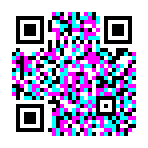
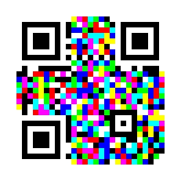

# colorqr

A Go implementation of HCC2D (High Capacity Colored 2-Dimensional code), a
QR-based 2D color barcode, with 4-color (2 bits/module) and 8-color
(3 bits/module) schemes. It follows:

> M. Querini and G. F. Italiano, "Color Classifiers for 2D Color Barcodes",
> FedCSIS 2013, pp. 611–618.

The paper is freely available from the [FedCSIS 2013 proceedings](https://annals-csis.org/Volume_1/pliks/67.pdf).

| 4 colors | 8 colors |
|:-:|:-:|
|  |  |

Both examples hold the same 77-byte text at EC level M: the 4-color one is a
version 3 symbol (29×29 modules), the 8-color one is version 2 (25×25). The
colored strips around the edge are the Color Palette Patterns.

There is also a [demo web app](#web-app) that creates and scans codes in the
browser.

## Sources

The FedCSIS 2013 paper describes HCC2D only briefly. Where it leaves
something open, this implementation follows the paper that introduced the
format:

> A. Grillo, A. Lentini, M. Querini and G. F. Italiano, "High Capacity
> Colored Two Dimensional Codes", IMCSIT 2010, pp. 709–716
> ([PDF](https://annals-csis.org/proceedings/2010/pliks/79.pdf)).

The journal version that the 2013 paper cites for details (Querini et al.,
"2D color barcodes for mobile phones", IJCSA 8(1), 2011) is not freely
available, so the palette pattern layout is taken from its Figure 3, which the
2013 paper reproduces.

## Symbol structure

HCC2D keeps every QR function pattern in black and white, in its QR position,
and puts colors only in the data and error correction area:

- **QR function patterns**, all as specified in ISO/IEC 18004: the three
  finder patterns with separators, timing patterns, alignment patterns
  (versions 2–40), the dark module, two copies of the 15-bit BCH format
  information (EC level and mask, unchanged from QR), and two copies of the
  18-bit version information (versions 7+). Sizes are 21×21 (version 1) up to
  177×177 (version 40).
- **Color Palette Patterns**: four strips, one module thick, in the ring just
  outside the QR grid, so together they take "only 2 rows and 2 columns"
  (FedCSIS 2013, Figure 3). Each strip repeats the palette (cell *k* shows color
  *k* mod *n*) for as many whole cycles as fit, starting next to a finder
  pattern's separator: the top strip rightwards from the top-left finder, the
  left strip upwards from the bottom-left finder, the bottom strip rightwards
  from the bottom-left finder, the right strip downwards from the top-right
  finder. The top and left strips stop at the opposite finder; the bottom and
  right strips run to the far corner. The decoder averages them to learn how
  each color looked after printing and scanning, and finds the number of
  colors from their period.
- **Data modules**: exactly QR's, filled in QR placement order (two-column
  zig-zag from the right). Each module carries 2 or 3 bits.

### Colors

Each bit acts as one subtractive ink (C, M, Y), so all bits clear is white and
all bits set is black. The 4-color assignment is the paper's example (black
11, cyan 10, magenta 01, white 00). The papers give no 8-color assignment.

| value | 4-color | 8-color |
|------:|---------|---------|
| 0 | white | white |
| 1 | magenta | yellow |
| 2 | cyan | magenta |
| 3 | black | red |
| 4 | | cyan |
| 5 | | green |
| 6 | | blue |
| 7 | | black |

You can pass a custom palette to the encoder. The decoder needs no settings
for it, because it learns the colors from the palette patterns.

### Encoding rules

- **Code tables.** The 2010 paper derives the HCC2D tables from QR's by
  multiplying the codeword counts (and the remainder bits) by the bits per
  module. This implementation does that by repeating every QR Reed-Solomon
  block of ISO/IEC 18004 Table 9 two or three times, so each EC level keeps
  QR's block sizes and its correction capability (L ≈ 7%, M ≈ 15%, Q ≈ 25%,
  H ≈ 30% of codewords). Blocks are interleaved as in QR. Reed-Solomon works
  over GF(256) with the QR polynomial and generator. The decoder uses
  Berlekamp-Massey, Chien search and Forney.
- **Segments.** QR's numeric, alphanumeric and byte modes; the encoder picks
  the most compact single mode for the payload. As the 2010 paper specifies,
  the byte-mode character count is always 16 bits, and the numeric and
  alphanumeric counts get ⌈BpM/2⌉ more bits than in QR. The decoder also skips
  ECI designators. Kanji mode is not supported.
- **Masking.** The eight QR mask patterns. Following the 2010 paper, a masked
  module has every bit flipped (its value is complemented, so each color swaps
  with its opposite: white↔black, cyan↔magenta), and the mask is chosen with
  QR's four penalty rules applied to the symbol seen as dark (the darker half
  of the palette) and light modules.

### Capacity (bytes, EC level L)

| version | QR | 4-color | 8-color |
|--------:|---:|--------:|--------:|
| 1  | 17 | 35 | – |
| 10 | 271 | 545 | 819 |
| 40 | 2,953 | 5,909 | 8,865 |

Numeric and alphanumeric payloads hold more characters; see
`colorqr.CapacityMode`. Version 1 has no room for one 8-color palette cycle
between the finders, so 8-color symbols start at version 2.

### What the papers leave open

- The 8-color value assignment (see above).
- How the decoder tells 4 from 8 colors. The format information has no room for
  it if it stays as in QR, so the decoder reads it from the palette patterns:
  read as 8-color strips, a 4-color symbol repeats every color after four
  cells. Reed-Solomon confirms the guess, and the other scheme is tried if it
  fails.
- The 2013 paper reports 512 palette cells and 19,720 data cells for its
  149×149 4-color symbols. The layout of its Figure 3 gives 544 palette cells
  at that size, and QR version 33 has 20,891 data modules. The paper does not
  explain the difference.

## Decoding

1. Binarize the image by luma, first with one global (Otsu) threshold, then,
   if that fails, with local thresholds for unevenly lit photos. Find finder
   patterns by their 1:1:3:1:1 run ratio, cross-checked horizontally,
   vertically and diagonally.
2. Pick the three finders that form a right isosceles triangle. That gives
   the orientation, which works for any rotation.
3. Map module coordinates to pixels with the affine transform that the three
   finder centers define. For versions 2 and up, look for the bottom-right
   alignment pattern near where that predicts it and switch to the
   perspective transform (homography) through all four points. Estimate the
   version from the finder spacing and confirm it with the version
   information and the checks below.
4. Read the format information (EC level, mask).
5. Average each palette color over its palette-pattern cells, picking 4 or 8
   colors as described above. Then classify the data modules with **K-means
   seeded by those colors** in YUV (the paper's best classifier) or with the
   **minimum Euclidean distance** baseline.
6. Unmask, de-interleave, run Reed-Solomon correction, and parse the
   segments.

The tests check decoding under 90°/180°/270° and arbitrary rotations,
scaling, 2 px modules, Gaussian noise, a simulated print-and-scan color cast
with uneven lighting, JPEG compression, randomly recolored modules, and
simulated phone photos (perspective, lighting falloff, color cast, blur,
noise). Very steep angles (one edge looking about 1.6× longer than the other)
still defeat finder detection, and a single homography does not model a
curved or crumpled print.

## CLI

```sh
go build -o colorqr ./cmd/colorqr

colorqr encode -o hello.png "Hello, color QR!"          # 4 colors, EC L
colorqr encode -colors 8 -ec M -o data.png < file.bin  # 8 colors, EC M
colorqr encode -version 10 -module 4 -o big.png "hi"   # force a larger symbol
colorqr encode -o num.png 31415926535897932384          # numeric mode
colorqr decode -v hello.png                            # prints symbol info to stderr
colorqr decode -classifier euclidean -o out.bin data.png
```

## Library

```go
import "git.foxden.network/FoxDen/hcc2d/pkg/colorqr"

// Encode to PNG.
err := colorqr.Encode(w, data, &colorqr.EncodeOptions{
	Scheme: colorqr.EightColor,
	Level:  colorqr.ECMedium,
})

// Or build a symbol and render it yourself.
sym, err := colorqr.NewSymbol(data, nil)
img := sym.Image(8, 4) // 8 px per module, 4-module quiet zone (palette ring included)

// Decode from any PNG, JPEG or GIF (or an image.Image with DecodeImage).
res, err := colorqr.Decode(r, nil)
fmt.Println(res.Version, res.Scheme, res.Level, res.Corrected, string(res.Data))
fmt.Println(res.Corners) // where the symbol is in the image
```

## Web app

`web/` holds a demo app that runs entirely in the browser. The Go codec is
compiled to WebAssembly and runs in a Web Worker.

- **Create**: content types like common QR generators (URL, text, Wi-Fi,
  contact/vCard, email, SMS, phone, location, calendar event), 4 or 8 colors,
  EC level, minimum version, module size, quiet zone and a custom palette.
  Shows a live preview and the symbol's statistics. Exports PNG and SVG, copies
  to the clipboard, and has "Test scan" to decode the result in the browser.
- **Scan**: upload, drag and drop, or paste an image, or use the camera.
  Large photos are downscaled first (with a retry at higher resolution). The
  camera view decodes frames back to back in the worker, picks the
  rear camera on phones (with a switcher when there are several), and freezes
  the first frame that decodes. Camera access needs HTTPS or localhost. The app outlines the
  detected symbol and recognizes the same payload formats, with actions:
  open link, write email, save contact (.vcf), add to calendar (.ics), and
  others. Binary payloads get a hex dump and a download.

```sh
make web     # builds web/colorqr.wasm and copies Go's wasm_exec.js
make serve   # serves web/ on http://localhost:8080/
```

Any static file server works too.

## Tests

```sh
go test ./...          # full suite, including every version for both schemes
go test -short ./...   # quicker subset
```

## License

Licensed under the [GNU Affero General Public License v3.0](LICENSE) (AGPL-3.0-or-later).
